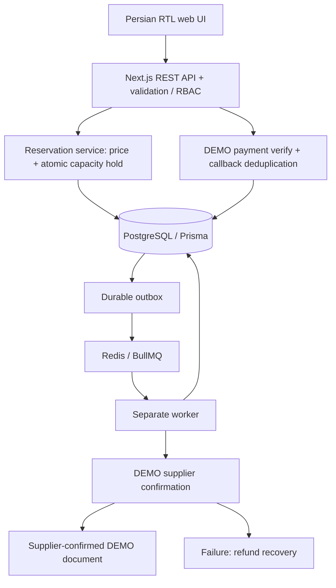

# BERJIS — architecture and delivery contract

## Scope and trust boundary

A Persian RTL Next.js App Router application with a modular TypeScript service layer, PostgreSQL/Prisma as the source of truth, Redis rate limits/search cache, and a BullMQ worker. All inventory, prices, gateway transactions, confirmations, and documents are **DEMO** until contractual adapters are implemented. No live financial or travel claim is made. Amounts are integer IRR; UI converts to toman. Dates are stored as UTC ISO dates and displayed using the Persian calendar.

## Modules

- Identity: scrypt passwords, hashed opaque HttpOnly sessions, server authorization, explicit role permission mapping.
- Catalog: supplier adapter interfaces; advisory search offers with server revalidation and immutable reservation-price snapshots for flights, hotels, tours. Server recalculates all totals.
- Reservations: transactional capacity holds with expiry; ownership checks; independent booking/payment/fulfilment states.
- Payments: idempotent transaction creation, server-side verification of provider transaction, signed callbacks, event deduplication, amount/currency/order checks.
- Fulfilment: durable PostgreSQL outbox dispatched to BullMQ, idempotent DEMO supplier issuance. Paid-but-unissued orders enter recovery/refund states, never confirmed.
- Operations: customer orders/refunds/support, role-gated admin inventory/tour content/financial export, append-only application audit events.

## Database design (before implementation)

User 1—N Session, Traveler, Reservation, SupportTicket. User has a role. Supplier 1—N Offer. Offer 1—1 Inventory and N—1 optional Tour. Reservation N—1 Offer, 1—N Passenger, 1—1 Payment, 1—1 Document, 1—N AuditLog, 1—N Refund. Payment 1—N PaymentEvent and 1—1 DemoGatewayTransaction. DurableJob uses a unique logical key and stores retries/availability. Article and SystemSetting store editorial content. Monetary columns are integers; indexes cover owner/date, state/expiry, provider IDs, unique email, idempotency keys, event IDs and job keys.

## Transaction invariants

1. Capacity is decremented using a conditional UPDATE (`available >= quantity`) in the same transaction as reservation creation. Expiration/cancellation releases it exactly once using a conditional state transition.
2. `(userId, idempotencyKey)` is unique. Reusing a key for a different request is rejected.
3. Pending holds expire after 15 minutes. A payment may only be created/verified against an active hold. A late successful debit enters refund recovery; inventory is never reclaimed from another customer.
4. Verified payment, audit event and fulfilment outbox entry commit atomically. Callback replay returns the existing result. Callback data is not evidence of payment: provider verification is required.
5. Fulfilment and payment are independent. Documents are created only after the supplier confirms. Supplier failure enters REFUND_PENDING. Retryable worker failures retain a durable outbox entry.
6. Supplier issuance uses a stable reservation idempotency key; retries must not issue duplicate documents. Database locks/conditional updates protect cancellation races.
7. Refund acceptance is separate from actual settlement. Demo settlement must be labelled; no real refund is claimed.

## API, UI and deployment

Same-origin JSON REST API under `/api/v1`, Zod validation, centralized redacted errors, Redis rate limiting, role/ownership checks, HMAC callback verification. Public UI: home, search results, service details, checkout, login, editorial/information pages. Private UI: account/orders/travelers/refunds/support; admin: summary/orders/catalog/finance/audit.

## Delivery phases and verification

1. Architecture, schema, design system and responsive Persian UI.
2. Migration, auth/session/RBAC, search/cache and capacity transactions.
3. Flight/hotel/tour sandbox purchase, callback verification, durable issuance, cancellation/refund recovery.
4. Admin operations, customer tools, documentation and export.
5. Live integrations: external prerequisite (contracts, supplier API specifications, payment sandbox/live credentials, SMS/email services); deliberately not implemented by guessing.
6. PostgreSQL/Redis integration tests including callback tampering/replay, concurrency, expiry and fulfilment failure; browser E2E; production build. Production hardening and external security/performance review remain a release gate.

## Runtime flow

Existing-reservation mutations lock the reservation row before payment/inventory children. Database-only Serializable callbacks retry PostgreSQL SQLSTATE 40001/40P01, whether surfaced directly by the JS adapter or wrapped as Prisma P2010/P2034; unique-key races are also retried. External provider effects run outside this retry boundary and must use stable idempotency keys. A deterministic test creates a real PostgreSQL deadlock and verifies that rollback/retry loses no writes.

Redis cache/rate-limit keys and BullMQ queue names use a namespace. By default it derives from the database name; configure `REDIS_NAMESPACE` explicitly when multiple environments share Redis and database names. Tests use a unique namespace per run. Synthetic test fixtures are removed by their exact recorded IDs; they do not leave active test administrators in the demo application.
